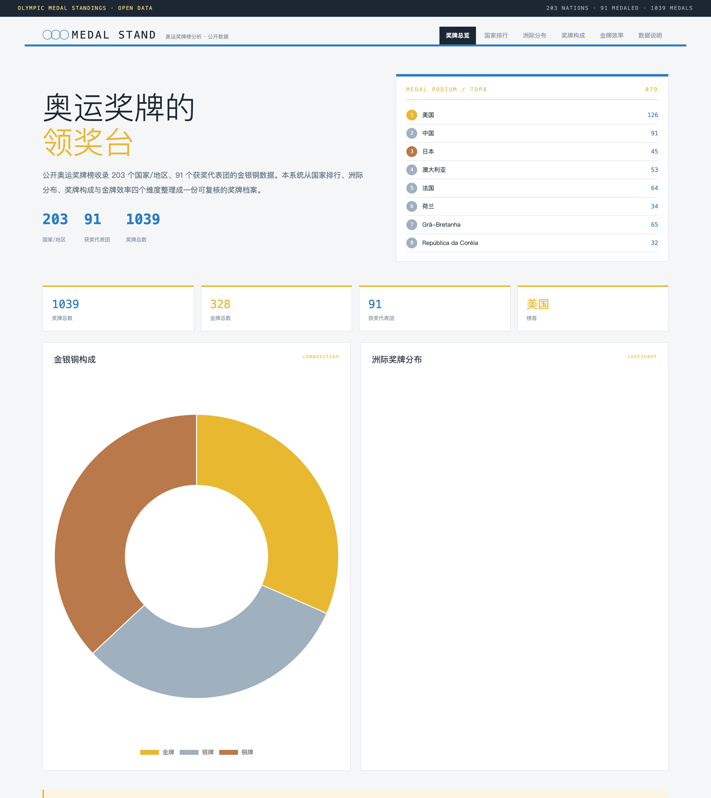
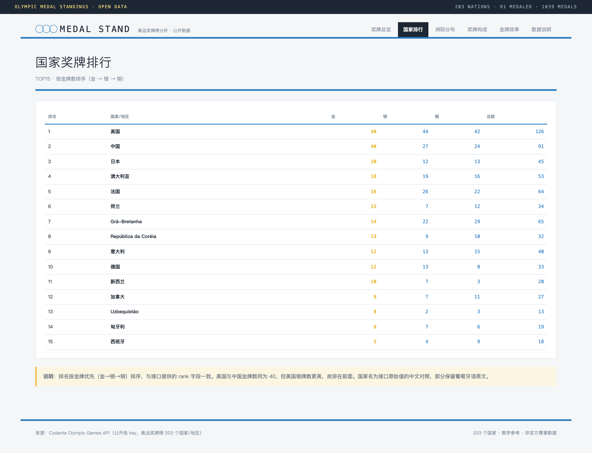
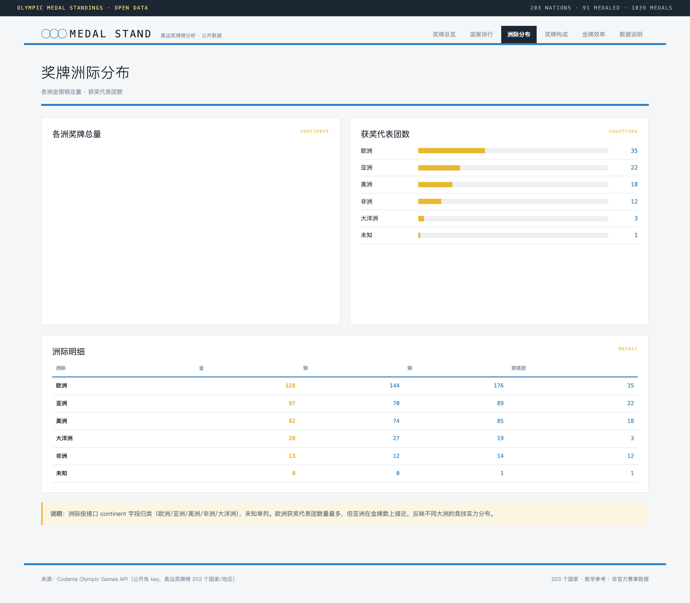
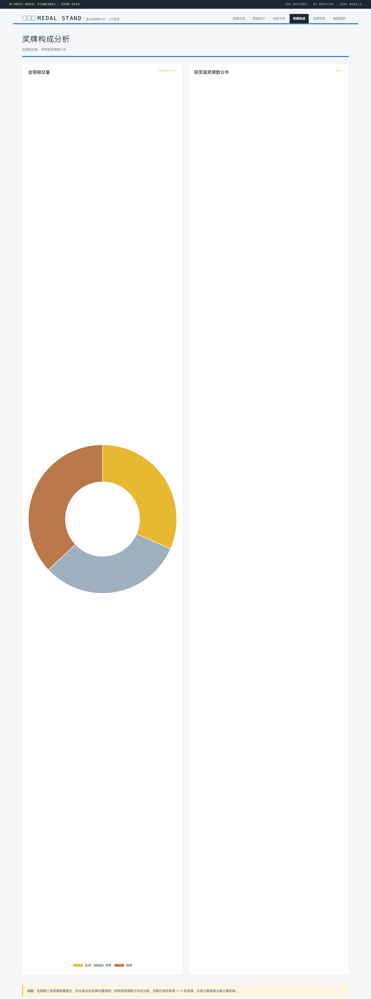
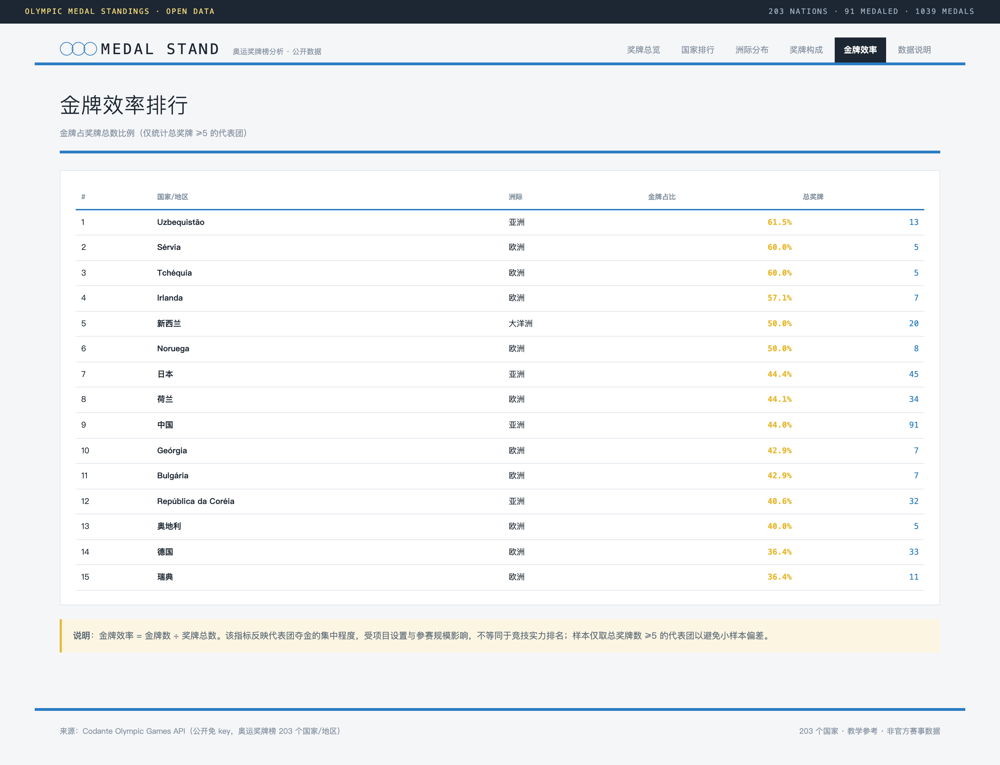
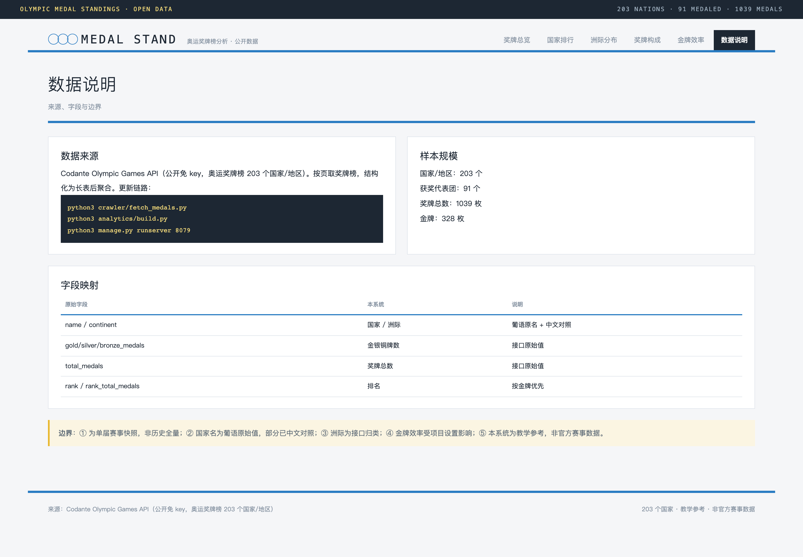

# 079 基于公开奥运奖牌数据的奥运会奖牌榜分析系统-设计展示

> **代码有偿获取 可接受定制 微信联系方式: csbysj2020 或 ACE2487，备注(BS)**

> **完整源码与全套文档 · 在线自助获取 >>> [https://mbd.pub/o/bread/YZaWmJpwbQ==](https://mbd.pub/o/bread/YZaWmJpwbQ==)**

> **成品页（功能介绍 / 更多选题）>>> [https://bishe.suilang.net/products/medal-stand](https://bishe.suilang.net/products/medal-stand)**

> 

> 

## 视频

> **点击查看 >>> [https://www.bilibili.com/video/BV1eXybzvEs2/](https://www.bilibili.com/video/BV1eXybzvEs2/)**

## 项目简介

奥运领奖台风格（奥运白、五环色、金银铜、领奖台），区别于预警中心/监测台/安全档案。采集公开奥运奖牌数据 203 国（91 获奖、1039 枚奖牌），从国家排行、洲际、构成与金牌效率四维分析。Django + Chart.js（本地化离线可用），6 个页面。单届快照与葡语字段对照如实标注，非官方赛事数据。

奥运奖牌榜是观察各国竞技体育实力的数据窗口。

本项目设计并实现了一套基于公开奥运奖牌数据的奖牌榜分析系统：通过开放 API 分页获取 203 个国家/地区（其中 91 个获奖）的金银铜牌与排名数据，结构化为长表后从国家排行、洲际分布、奖牌构成与金牌效率四个维度聚合分析。

系统采用 Django + Chart.js 与奥运领奖台式界面（奥运白、五环色、金银铜、领奖台），实现奖牌总览、国家排行、洲际分布、奖牌构成、金牌效率、数据说明 6 个页面。

本仓库为**设计展示**：包含项目说明、技术架构、实验结果与运行截图；完整源码、任务书、开题报告、毕业论文与使用说明可通过上方链接自助获取，成品页可查看更多选题，也可联系微信咨询定制。

## 功能特性

1. 差异化视觉：奥运领奖台（奥运白/五环色/金银铜），非看板/画廊/预警中心

2. 真实采集：公开奥运奖牌 API 分页取 203 国数据

3. 国家排行：金牌榜 TOP15，金→银→铜排序

4. 洲际分布：各洲金银铜堆叠与获奖代表团数

5. 奖牌构成：1039 枚奖牌金银铜结构与获奖国长尾分布

6. 金牌效率：金牌占比排行（总奖牌≥5）

7. 技术栈差异化：Django + Chart.js（本地化）

8. 合规边界：单届快照、葡语字段、非官方赛事数据

## 技术架构

| 项目 | 说明 |
| --- | --- |
| 编程语言 | Python 3.8+ |
| Web 框架 | Django 4.2 |
| 图表 | Chart.js（本地化离线可用） |
| 数据源 | 公开奥运奖牌 API（免 key） |
| 样本规模 | 203 国 / 91 获奖 / 1039 奖牌 |
| 运行端口 | http://127.0.0.1:8079 |
| 说明 | 数据直读 analysis JSON，无需数据库 |

## 目录结构

以下为完整交付版的结构（本仓库仅作设计展示）：

```
medal-stand/
├── analytics/
│   └── build.py
├── crawler/
│   └── fetch_medals.py
├── data/
│   ├── analysis/
│   │   ├── composition.json
│   │   ├── continent_countries.json
│   │   ├── continents.json
│   │   ├── efficiency.json
│   │   ├── top15.json
│   │   └── total_bins.json
│   ├── processed/
│   │   └── medals.csv
│   └── stats.json
├── medalapp/
│   ├── __init__.py
│   └── app.py
├── medalproj/
│   ├── __init__.py
│   ├── settings.py
│   ├── urls.py
│   └── wsgi.py
├── static/
│   ├── css/
│   │   └── style.css
│   └── vendor/
│       └── chart.umd.min.js
├── templates/
│   ├── about.html
│   ├── base.html
│   ├── composition.html
│   ├── continents.html
│   ├── efficiency.html
│   ├── overview.html
│   └── ranking.html
├── 任务书/
│   └── 毕业设计任务书.docx
├── 开题报告/
│   └── 毕业设计开题报告.docx
├── 最终论文/
│   ├── 图/
│   └── …
└── …
```

## 数据与实验结论

- 实验显示样本共 1039 枚奖牌，美国 居金牌榜首，欧洲获奖代表团数量最多。
- 真实采集：公开奥运奖牌 API 分页取 203 国数据
- 国家排行：金牌榜 TOP15，金→银→铜排序
- 奖牌构成：1039 枚奖牌金银铜结构与获奖国长尾分布

## 交付内容

1. 完整源码（Django 应用 + 采集器 + 分析引擎 + 6 页面）
2. 真实数据（medals.csv + analysis JSON）
3. 任务书与开题报告（Word）
4. 毕业论文（Word 七章制）
5. 二次开发说明（Word+md）
6. 6 张截图 + 封面 + 演示视频

## 常见问题

**国名为什么有的是葡语？**

接口原始名为葡语，常见国家已做中文对照，其余保留原文。

**排名怎么算的？**

按金牌优先（金→银→铜），与接口 rank 字段一致。

**金牌效率是什么？**

金牌数÷奖牌总数，仅统计总奖牌≥5 的代表团，受项目设置影响。

**图表能离线用吗？**

能，chart.umd.min.js 已本地化到 static/vendor/。

## 截图







